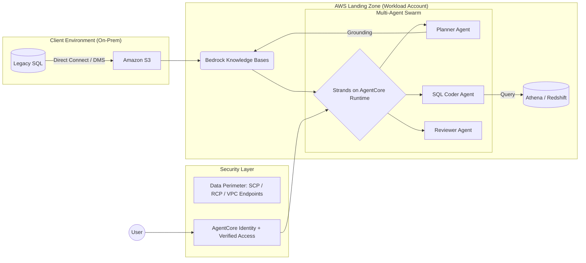

# 🚀 Awesome Forward Deployment Engineering (FDE) — AWS Edition

[](https://awesome.re)
[]()
[]()

> **About this file:** This is an AWS-focused adaptation of [README.md](README.md) (the upstream, GCP-focused roadmap by Pier Paolo Ippolito and Paolo Perrone). The structure mirrors the upstream README section-for-section so upstream changes can be ported easily. Vendor-neutral content (consulting, air-gap compliance, reading list) is kept as-is; GCP-specific content is replaced with AWS equivalents.
>
> **Synced with upstream:** `24d652e` (2026-10-15). See [Keeping This File in Sync](#-keeping-this-file-in-sync) at the bottom.

Forward Deployment Engineering is the art of shipping complex software where it matters most. It is a hybrid role—part **Software Engineer**, part **AI/Data Architect**, and part **Strategic Consultant**.

FDEs are the "Technical Special Ops" who bridge the gap (The Delta) between a core product and a client’s messy, real-world reality.

---

## 📑 Table of Contents
1. [**The FDE Persona & Mission**](#-the-fde-persona--mission)
2. [**The Master Curriculum**](#-the-master-curriculum)
   - [Phase 1: Data Engineering](#phase-1-data-engineering-the-bedrock)
   - [Phase 2: Cloud Architecture (AWS)](#phase-2-cloud-architecture--infrastructure-the-vehicle)
   - [Phase 3: The Consulting Mindset](#phase-3-the-consulting-mindset-the-forward-in-fde)
3. [**The Applied AI & Technical Playbook**](#-the-applied-ai--technical-playbook)
   - [Multi-Agent Orchestration (Strands + AgentCore)](#-multi-agent-orchestration-with-strands-agents--amazon-bedrock-agentcore)
   - [LLM Systems Evaluation](#%EF%B8%8F-llm-systems-evaluation-the-success-key)
   - [Enterprise RAG Blueprint](#-the-enterprise-rag-blueprint)
4. [**Air-Gapped & Tactical Edge Deployment**](#-air-gapped--tactical-edge-deployment)
5. [**The "Soft Stack": Consulting & Strategy**](#-the-soft-stack-consulting--strategy)
6. [**The Interview Blackbook & Case Studies**](#-the-interview-blackbook--case-studies)
7. [**Artifact Templates (Copy-Paste)**](#-artifact-templates-copy-paste)
8. [**Comprehensive Reading List**](#-comprehensive-reading-list)
9. [**The FDE Glossary**](#-the-fde-glossary)
10. [**GCP → AWS Translation Table**](#-gcp--aws-translation-table)
11. [**Keeping This File in Sync**](#-keeping-this-file-in-sync)

---

## 🛸 The FDE Persona & Mission
The FDE is the **bridge** between the "Perfect Code" of HQ and the "Messy Reality" of the Client.

*   **The Problem:** Standard software often fails when it hits real-world data (corrupt schemas, air-gapped servers, political resistance).
*   **The Solution:** The FDE. They don't just "fix bugs"—they architect solutions, manage stakeholders, and write the "glue code" that makes a multi-million dollar contract successful.

In traditional Software Engineering (SWE), you build for a "user persona". In FDE, you build for a **mission**.

| Feature | Software Engineer (SWE) | Forward Deployed Engineer (FDE) |
| :--- | :--- | :--- |
| **User** | Millions of anonymous users | High-stakes stakeholders (CTOs, Generals, CEOs) |
| **Environment** | Controlled, uniform cloud | Hostile, legacy, air-gapped, or hybrid infra |
| **Goal** | Scale and stability | Speed-to-value and problem-solving |
| **Code Ratio** | 90% Features | 50% Integration/Glue, 50% Strategy |

### 🛠 The Modern FDE Stack

#### Core Tools
*   **Languages:** `Python` (Data/AI), `Go` (Infra), `SQL` (Everything), `TypeScript` (AWS CDK).
*   **Data:** `dbt` (Transformation), `DuckDB` (Local processing), `Apache Spark`, `Apache Iceberg`.
*   **Cloud:** `Terraform` / `AWS CDK` (IaC), `Helm` (K8s packaging), `AWS`.
*   **Observability:** `Prometheus`, `Grafana`, `Loki`, `OpenTelemetry` (via ADOT).

---

### 🎓 The Master Curriculum

### Phase 1: Data Engineering (The Bedrock)
*The FDE mission usually starts with a "Data Audit". If you can't untangle a client’s 20-year-old schema, you can't build on top of it.*

*   **Advanced SQL & Query Tuning:** Beyond `JOINs`. You must master Window Functions, Recursive CTEs, and Query Optimization. You should be able to look at an EXPLAIN plan and identify why a query is scanning 10TB of data unnecessarily.
*   **Data Modeling for Reality:** Understand **Star Schema** vs. **One Big Table (OBT)**. Learn to design schemas that balance write-performance with user-readability.
*   **The Medallion Architecture:**
    *   **Bronze:** Raw landing zone (immutable) — typically an S3 prefix or bucket.
    *   **Silver:** Filtered, joined, and cleaned (the "Single Source of Truth") — typically Iceberg tables.
    *   **Gold:** Business-ready aggregates (Powering the UI/AI).
*   **Open Table Formats on S3:** On AWS, the lakehouse is built on **Apache Iceberg** — either self-managed in S3 with the **AWS Glue Data Catalog**, or via **Amazon S3 Tables** (managed Iceberg with automatic compaction). Learn snapshot isolation, schema evolution, and partition evolution.
*   **Distributed Computing:** Understanding **Spark/Ray** partitioning (on **Amazon EMR** or **AWS Glue**). You must know how to debug "Data Skew" and "OOM (Out of Memory)" errors when processing client datasets that exceed local memory.
*   **Data Quality & Observability:** Implementing "Circuit Breakers" for data (e.g., **AWS Glue Data Quality** rules or dbt tests). If a client's upstream data breaks, your pipeline should alert you before the CEO sees a broken dashboard.

#### 📚 Phase 1 Resources
*   **[Select Star SQL](https://selectstarsql.com/):** An interactive book to master SQL through real-world data.
*   **[Designing Data-Intensive Applications (DDIA)](https://www.oreilly.com/library/view/designing-data-intensive-applications/9781491903063/):** The "Bible" for understanding how data systems actually work under the hood.
*   **[dbt Fundamentals](https://courses.getdbt.com/courses/fundamentals):** The standard for turning "Data Engineering" into "Analytics Engineering".
*   **[DuckDB for FDEs](https://duckdb.org/docs/):** A critical tool for fast, local analysis of client CSV/Parquet files without setting up a full cluster.
*   **[Apache Iceberg Docs](https://iceberg.apache.org/docs/latest/):** The table format underneath most modern AWS lakehouses — learn it once and it transfers to Athena, EMR, Glue, Redshift, and S3 Tables.

---

### Phase 2: Cloud Architecture & Infrastructure (The Vehicle)
*FDEs are often "dropped" into complex cloud environments. You must move beyond writing code to architecting the "Landing Zone" where that code lives. Using **AWS** as our standard, you must master how to securely deploy and scale within a client's AWS Organization.*

*   **Multi-Account Landing Zones (The AWS Unit of Isolation):**
    *   **AWS Organizations + AWS Control Tower:** On AWS, the *account* is the primary security and billing boundary (roughly where GCP uses projects). Expect to deploy into a dedicated workload account inside the client's Organization, governed by **Service Control Policies (SCPs)** you did not write.
    *   **IAM Identity Center:** Human access via permission sets federated from the client's IdP (Okta, Entra ID). Never ask for long-lived IAM user access keys.
*   **Cloud Networking & Security (VPC Mastery):**
    *   **Regional VPCs:** Unlike GCP's global VPC, an AWS VPC is regional. Learn subnet/AZ design, route tables, and NAT Gateway cost traps.
    *   **Shared VPCs & Hub-and-Spoke:** Share subnets across accounts with **AWS Resource Access Manager (RAM)**; connect many VPCs with **AWS Transit Gateway** (or **AWS Cloud WAN** for global networks).
    *   **Secure Connectivity:** Implementing **AWS Direct Connect** or **AWS Site-to-Site VPN** to bridge a client's on-prem data center to AWS.
    *   **Private Access to Services:** **VPC endpoints (AWS PrivateLink)** let workloads reach S3, Bedrock, and other services without traversing the internet — often a hard requirement in regulated clients.
    *   **Zero-Trust:** Using **AWS Verified Access** to grant access to internal apps without a VPN (the closest analog to GCP's IAP).
*   **Kubernetes as a Standard (Amazon EKS):**
    *   **EKS Auto Mode vs. Standard:** Knowing when to trade control (self-managed node groups, Karpenter) for operational ease (AWS-managed compute, networking, and storage).
    *   **EKS Pod Identity (and IRSA):** The gold standard for security—allowing Kubernetes service accounts to assume IAM roles without managing static credentials.
    *   **Private Clusters:** Deploying EKS with a private-only API endpoint and no public node IPs to satisfy strict enterprise security requirements.
*   **Data Architecture on AWS:**
    *   **Analytics Engines:** **Amazon Redshift** (sort keys and distribution styles) for warehouse workloads, **Amazon Athena** (partitioning and file sizing) for serverless SQL over S3.
    *   **Serverless Pipelines:** Using **AWS Lambda**, **AWS Step Functions**, or **Amazon ECS on AWS Fargate** for lightweight, event-driven data processing.
    *   **Streaming & Messaging:** **Amazon Kinesis Data Streams**, **Amazon MSK** (managed Kafka), **Amazon EventBridge**, and **Amazon SQS/SNS** as the real-time "glue" between client systems and your platform.
*   **Data Exfiltration Prevention (Data Perimeters):**
    *   AWS has no single "VPC Service Controls" product. Instead, FDEs in high-security sectors (Finance/Gov) build a **data perimeter** from three layers: **SCPs** (what your principals can do), **Resource Control Policies (RCPs)** (who can access your resources), and **VPC endpoint policies** (which resources your network can reach) — combined with condition keys like `aws:PrincipalOrgID` and `aws:SourceVpce`.
*   **Infrastructure as Code (Terraform / AWS CDK):**
    *   Automating the entire "FDE Environment". If you can’t spin up an EKS cluster, an S3 + Athena lakehouse, and least-privilege IAM roles in 5 minutes via Terraform or CDK, you aren't ready to deploy "forward".

#### 📚 Phase 2 Resources (AWS Focused)
*   **[AWS Well-Architected Framework](https://docs.aws.amazon.com/wellarchitected/latest/framework/welcome.html):** The definitive guide to building secure, resilient, and cost-effective systems on AWS — and the vocabulary client architects will use in your design reviews.
*   **[Amazon EKS Best Practices Guide](https://docs.aws.amazon.com/eks/latest/best-practices/introduction.html):** Essential reading for security, networking, and scaling patterns inside a cluster.
*   **[Terraform Provider for AWS](https://registry.terraform.io/providers/hashicorp/aws/latest/docs):** The documentation you will live in daily.
*   **[AWS CDK Developer Guide](https://docs.aws.amazon.com/cdk/v2/guide/home.html):** Worth learning even if you prefer Terraform — the AgentCore CLI and many AWS samples provision through CDK under the hood.
*   **[AWS Skill Builder](https://skillbuilder.aws/):** Hands-on labs and learning plans; the Data Engineer and Generative AI learning plans map directly to Phases 1 and 3 of this roadmap (some content requires a paid subscription).
*   **[Data Perimeters on AWS](https://aws.amazon.com/identity/data-perimeters-on-aws/):** A critical skill for FDEs working with sensitive enterprise data — the AWS answer to "how do we prevent exfiltration?"
*   **[AWS Security Reference Architecture (SRA)](https://docs.aws.amazon.com/prescriptive-guidance/latest/security-reference-architecture/welcome.html):** How AWS recommends laying out security services across a multi-account Organization — the map of the client environment you will be dropped into.
*   **[The Amazon Builders' Library](https://aws.amazon.com/builders-library/):** How Amazon itself handles timeouts, retries, deployments, and load shedding — the operational wisdom that keeps client deployments alive.
*   **[Google SRE Workbook](https://sre.google/workbook/table-of-contents/):** Cloud-agnostic; specifically the "Monitoring" and "Incident Response" chapters to keep client deployments alive.

---

### Phase 3: The Consulting Mindset (The "Forward" in FDE)
*An FDE is a "Technical Diplomat". You must solve the people problems to allow the technical solutions to work.*

*   **Structured Problem Solving (MECE):** Mutually Exclusive, Collectively Exhaustive. Break a massive "AI Strategy" into small, non-overlapping technical tasks.
*   **The Pyramid Principle:** Start with the answer first. Executives want the "So What?" before the technical "How".
*   **80/20 Value Scoping:** Identify the 20% of features that will solve 80% of the client's pain. Avoid "Gold-Plating" (building complex features no one asked for).
*   **The Art of the Discovery Call:** Learning to ask "Why?" five times to find the root cause of a business problem.
*   **Requirements Translation:** Turning a CEO's "I want more efficiency" into a Jira Ticket for "Optimizing Route Pathfinding Algorithm".
*   **Working Backwards (AWS-flavored):** Amazon's PR/FAQ method — write the press release and FAQ *before* building. A useful forcing function for scoping a client engagement around the customer outcome.

#### 📚 Phase 3 Resources
*   **[The Trusted Advisor](https://trustedadvisor.com/books/the-trusted-advisor):** How to move from being a "vendor" to a "partner".
*   **[The Pyramid Principle (Summary)](https://medium.com/lessons-from-mckinsey/the-pyramid-principle-f0885dd3c5c7):** The gold standard for executive communication.
*   **[How to Win Friends and Influence People](https://www.amazon.com/How-Win-Friends-Influence-People/dp/0671027034):** Sounds cliché, but vital for dealing with resistant IT staff at client sites.
*   **[The McKinsey Way](https://www.amazon.com/McKinsey-Way-Ethan-M-Rasiel/dp/0070534489):** Frameworks for thinking about business problems like an engineer.
*   **[Working Backwards](https://www.amazon.com/Working-Backwards-Insights-Stories-Secrets/dp/1250267595) (Colin Bryar & Bill Carr):** The PR/FAQ and narrative-memo practices that AWS teams (and many AWS customers) use to make decisions — knowing them helps you speak the client's language.

---

## 📚 The Applied AI & Technical Playbook

As an FDE, you are the bridge between "State-of-the-Art" research and "Production-Grade" deployment. This section maps the architectures you must master and the AWS tools you will use to ship enterprise-grade value.

### 🏢 Industry Intelligence (The Gold Standard)
Read these to understand how elite teams solve the "messy reality" of enterprise deployment.
*   **[Palantir: Dev vs. Delta](https://blog.palantir.com/dev-versus-delta-demystifying-engineering-roles-at-palantir-ad44c2a6e87)** – The mandatory "Origin Story" of the FDE role.
*   **[OpenAI: Customer Stories](https://openai.com/customer-stories)** – Real-world case studies on deploying LLMs into complex workflows (e.g., Morgan Stanley, Harvey).
*   **[AWS Architecture Center](https://aws.amazon.com/architecture/)** – Reference architectures and decision guides for EKS, analytics, and generative AI on AWS.
*   **[Anthropic: Evaluating AI Agents](https://www.anthropic.com/engineering/demystifying-evals-for-ai-agents)** – Deep dive into the "Evals" mindset required for production AI.

---

### 🐝 Multi-Agent Orchestration with Strands Agents & Amazon Bedrock AgentCore
On AWS, the agent stack splits into two layers: a **framework** for writing the agent loop and a **platform** for running it in production.

*   **[Strands Agents](https://strandsagents.com/)** is AWS's open-source, model-driven agent SDK. You give it a model, a system prompt, and tools; the model plans the loop. It treats agent development like **software engineering**, with first-class MCP support and OpenTelemetry tracing.
*   **[Amazon Bedrock AgentCore](https://aws.amazon.com/bedrock/agentcore/)** is the managed platform for deploying and operating agents built with *any* framework (Strands, LangGraph, Google ADK, OpenAI Agents SDK, CrewAI) and *any* model.

#### Strands Core Primitives
*   **Multi-Agent Patterns:** Compose specialized agents as **Agents-as-Tools** (a "Manager" calls "Researcher" and "Coder" agents as tools), **Swarm** (agents hand off to each other), **Graph** (deterministic DAG of agents), or **Workflow** (fixed task sequences).
*   **The Agent2Agent (A2A) Protocol:** Strands supports A2A, the open standard that allows agents to discover and communicate with each other via consistent HTTP-based interfaces — including agents built on other clouds.
*   **Model Agnostic:** Defaults to Amazon Bedrock (Claude, Amazon Nova, Llama, Mistral), but also supports Anthropic, OpenAI, Gemini, Ollama, and LiteLLM providers.
*   **Deployment:** Native integration with **AgentCore Runtime** for managed, auto-scaling, session-isolated production deployment. In practice, most FDE teams drive this through the **AgentCore CLI** (below) rather than hand-rolling Terraform.

#### 🧩 AgentCore Building Blocks
| Service | What it covers |
| :--- | :--- |
| **Runtime** | Serverless, session-isolated hosting for agents and tools; supports long-running sessions and VPC deployment |
| **Memory** | Short-term (session) and long-term (cross-session) memory with retrieval strategies |
| **Gateway** | Turns existing APIs and Lambda functions into MCP tools with governed connectivity |
| **Identity** | Inbound auth (who can call the agent) and outbound OAuth/API-key credential vaulting (what the agent can call on the user's behalf) |
| **Code Interpreter / Browser** | Sandboxed code execution and managed headless browsing for agents |
| **Observability** | Traces, logs, and metrics in Amazon CloudWatch via OpenTelemetry |
| **Evaluations** | Online (production trace sampling) and on-demand (CI/CD) agent quality scoring — see the Evaluation section |
| **Policy** | Deterministic controls over which tools an agent may call and with what parameters, enforced outside the model |

#### 🧰 AgentCore CLI
The **[AgentCore CLI](https://github.com/aws/agentcore-cli)** (`@aws/agentcore`, the successor to the Python `bedrock-agentcore-starter-toolkit`) is AWS's lifecycle tool for AgentCore — scaffold, test locally, deploy, invoke, evaluate, observe. It provisions everything through AWS CDK, and each generated project ships an `AGENTS.md` so AI coding tools (Claude Code, Kiro, Cursor, Codex) understand the project layout.

**Why FDEs should care:** the tool bridges the local-prototype → cloud-production gap that historically required stitching together the AWS CLI, CDK/Terraform, ECR, IAM roles, and hand-written CI. It also offers a **managed harness** mode — declare model, prompt, tools, and memory in a config file and let AgentCore run the loop — which is the fastest way to stand up a credible demo in week one.

```bash
# One-time install (Node.js 20+, Python 3.10+, AWS credentials configured)
npm install -g @aws/agentcore

# Scaffold a code-based Strands agent on Bedrock
agentcore create \
  --project-name FinanceProject \
  --name FinanceAgent \
  --language Python \
  --framework Strands \
  --model-provider Bedrock \
  --memory none \
  --build CodeZip
cd FinanceProject

agentcore dev                                   # local server + agent inspector (traces, chat)
agentcore add evaluator                         # attach an AgentCore Evaluations evaluator
agentcore deploy --dry-run                      # preview the CDK changes
agentcore deploy                                # ship to AgentCore Runtime
agentcore invoke --prompt "Summarize last month's expense reports."
agentcore logs --since 30m --level error        # stream runtime logs
agentcore traces list                           # inspect recent traces
```

**Requirements:** Node.js 20+, npm, Python 3.10+, AWS credentials with AgentCore and CDK bootstrap permissions. Docker is only needed for the `Container` build type.

---

### ⚖️ LLM Systems Evaluation (The Success Key)
FDEs don't just "vibes-test" their agents; they use a two-loop evaluation framework to prove reliability to the client.

#### 1. The Inner Loop (Dev-Time Evaluation with Strands Evals)
Focuses on fast, manual, and interactive debugging during development.
*   **[Strands Evals SDK](https://strandsagents.com/docs/user-guide/evals-sdk/quickstart/)** (`pip install strands-agents-evals`): Test agent behavior against "Golden Datasets" with output, trajectory, tool-usage, and multi-turn evaluators, plus user simulators for realistic conversations.
*   **Metrics:** Trajectory evaluation (Did it use the right tools in the right order?), output evaluation with LLM-as-a-judge rubrics, and trace-based evaluation over OpenTelemetry spans.
*   **`agentcore dev`:** The local agent inspector lets you replay sessions and inspect traces before anything is deployed.

#### 2. The Outer Loop (Production Evaluation on AWS)
Scalable, automated evaluation for high-volume production data and CI/CD integration. FDEs use this to prove that a model update or a prompt change is a measurable improvement across thousands of test cases.

*   **[Amazon Bedrock AgentCore Evaluations](https://docs.aws.amazon.com/bedrock-agentcore/latest/devguide/evaluations.html)** (GA March 2026): **Online evaluation** continuously samples and scores live production traces; **on-demand evaluation** runs programmatically for regression testing in CI/CD. Ships 13 built-in evaluators (response quality, safety, task completion, tool usage) plus custom LLM-based or Lambda code-based evaluators.
*   **[Amazon Bedrock Evaluations](https://docs.aws.amazon.com/bedrock/latest/userguide/evaluation.html):** Model and **RAG evaluation** jobs using **LLM-as-a-judge**, programmatic metrics, or human reviewers. Use it to compare two candidate models or two Knowledge Base configurations side by side before a client commits to one (the AWS analog of pairwise evaluation).
*   **Pointwise Evaluation (The RAG Triad):** Assessing single responses against specific quality dimensions:
    *   **Faithfulness / Groundedness:** Does the response strictly follow the retrieved context? (Crucial for eliminating hallucinations.) **Amazon Bedrock Guardrails** can also enforce this at runtime with **contextual grounding checks**.
    *   **Instruction Following:** Did the agent actually follow the instructions in the system prompt?
    *   **Correctness, Completeness & Coherence:** Evaluating the linguistic quality and density of the output.
*   **[Amazon SageMaker AI Model Monitor](https://docs.aws.amazon.com/sagemaker/latest/dg/model-monitor.html)** (formerly Amazon SageMaker Model Monitor): Essential for "Day 2" operations on classic ML models. FDEs set up monitoring to detect **data drift**, **model quality drift**, and **feature attribution drift**, ensuring the system doesn't degrade over time as client data evolves.

---

### 🤖 The Enterprise RAG Blueprint
1.  **Ingestion:** Using **[Amazon Bedrock Data Automation](https://aws.amazon.com/bedrock/bda/)** or **[LlamaParse](https://developers.llamaindex.ai/python/framework/llama_cloud/llama_parse/)** to extract data from complex enterprise PDFs/tables.
2.  **Grounding:** Using **[Amazon Bedrock Knowledge Bases](https://aws.amazon.com/bedrock/knowledge-bases/)** as a managed RAG engine for chunking, embedding, and semantic retrieval over client data in S3, SharePoint, Confluence, and more.
3.  **Vector Storage:** Cost-efficient, high-scale indexing with **[Amazon S3 Vectors](https://aws.amazon.com/s3/features/vectors/)**, or low-latency indexing with **Amazon OpenSearch Serverless** / **Aurora PostgreSQL (pgvector)**.
4.  **Hybrid Search:** Combining semantic vectors with keyword-based BM25 search (supported in Knowledge Bases on OpenSearch-backed stores) to satisfy specific industry nomenclature.

---

### 🛠 The FDE Technical Deep-Dives

#### Cloud Architecture (AWS Focused)
*   **[Amazon Athena Performance Tuning](https://docs.aws.amazon.com/athena/latest/ug/performance-tuning.html):** Master partitioning, file sizing, and columnar formats for TB-scale client datasets — the fastest way to cut both query latency and the client's bill.
*   **[Data Perimeters on AWS](https://aws.amazon.com/identity/data-perimeters-on-aws/):** Mandatory for FDEs in Finance/Gov to satisfy data privacy requirements.
*   **[Infrastructure as Code (Terraform)](https://registry.terraform.io/providers/hashicorp/aws/latest/docs):** Automating the spin-up of EKS, the S3 lakehouse, and Bedrock/AgentCore environments.

#### Observability & Debugging
*   **[Amazon CloudWatch](https://aws.amazon.com/cloudwatch/)** (including Application Signals and generative AI observability): Tracking agent latency, token usage, and debugging failed tool calls in the field. AgentCore emits OpenTelemetry traces here by default.
*   **[AWS Distro for OpenTelemetry (ADOT)](https://aws-otel.github.io/):** Vendor-neutral instrumentation so the same traces can flow to CloudWatch, X-Ray, or the client's existing observability backend.
*   **[LangSmith (Tracing)](https://www.langchain.com/langsmith):** Framework-agnostic tracing to visualize exactly where an agent's "chain of thought" broke.
*   **[The System Design Primer](https://github.com/donnemartin/system-design-primer)** – The ultimate resource for architecting systems that don't crash under client load.

---

### 🚀 Key Resources
*   **[Strands Agents Documentation](https://strandsagents.com/)** – Start here to build your first multi-agent team.
*   **[Strands Agents SDK on GitHub](https://github.com/strands-agents/sdk-python)** – Source, examples, and the multi-agent pattern implementations.
*   **[AgentCore: Get Started with the CLI](https://docs.aws.amazon.com/bedrock-agentcore/latest/devguide/agentcore-get-started-cli.html)** – The scaffold → dev → deploy → invoke loop, end to end.
*   **[AgentCore CLI on GitHub](https://github.com/aws/agentcore-cli)** – Source, install instructions (`npm install -g @aws/agentcore`), and command reference.
*   **[Amazon Bedrock AgentCore Samples](https://github.com/awslabs/amazon-bedrock-agentcore-samples)** – End-to-end examples across frameworks and capabilities; the closest thing to a production starter pack.
*   **[Evaluating AI agents for production: A practical guide to Strands Evals](https://aws.amazon.com/blogs/machine-learning/evaluating-ai-agents-for-production-a-practical-guide-to-strands-evals)** – How to turn "it seems to work" into measurable eval suites.
*   **[AWS Well-Architected Generative AI Lens](https://docs.aws.amazon.com/wellarchitected/latest/generative-ai-lens/generative-ai-lens.html)** – The checklist client architecture boards will hold your GenAI design against.
*   **[Pinecone: RAG Learning Center](https://www.pinecone.io/learn/series/rag/)** – Best end-to-end RAG education.

---

## 📡 Air-Gapped & Tactical Edge Deployment
*The hardest FDE work happens where the internet doesn't reach: SCIFs, submarines, forward operating bases, offline factory floors, and regulated on-prem enclaves. Standard cloud playbooks fail here — you must ship the platform, not point at it.*

### 🔒 The Compliance Bedrock
Before you write code, know the classification and the accreditation path. These acronyms drive every architectural choice:
*   **ATO (Authority to Operate):** The signed authorization from a government agency's Authorizing Official permitting a system to run on their network. Achieved via the **[NIST Risk Management Framework](https://csrc.nist.gov/projects/risk-management/about-rmf)** and typically takes 6–18 months.
*   **DoD Impact Levels:** **IL2** (publicly releasable / non-critical unclassified), **IL4** (Controlled Unclassified Information), **IL5** (higher-sensitivity CUI + mission-critical / unclassified National Security Systems), **IL6** (classified up to Secret). On AWS, IL4/IL5 workloads typically land in **AWS GovCloud (US)**, while classified workloads run in the isolated **AWS Secret Region** and **AWS Top Secret** regions — each with a different, smaller service catalog.
*   **FedRAMP High vs. Moderate:** Federal civilian equivalent. Gen AI services and models often reach FedRAMP Moderate or commercial regions first — a hard blocker for many defense workloads. Check the **[FedRAMP Marketplace](https://marketplace.fedramp.gov/)** and **[AWS Services in Scope by Compliance Program](https://aws.amazon.com/compliance/services-in-scope/)** before promising a feature.
*   **STIGs (Security Technical Implementation Guides):** Line-by-line hardening checklists published by DISA for every OS, container image, and database. Your CI must produce STIG-compliant artifacts or ATO will bounce you.
*   **ITAR / EAR:** Export-control regimes. If your model was trained on ITAR-controlled data, its weights themselves are controlled — you cannot ship them to a non-US person, ever.
*   **CMMC 2.0:** The DoD contractor certification. Level 2 is the practical floor for FDE work in the defense industrial base; per DoD Class Deviation 2024-O0013 (May 2024) it currently assesses against **NIST SP 800-171 Rev. 2** (110 security requirements). Rev. 3 (May 2024, 97 requirements) is published but not yet the CMMC baseline — rulemaking to adopt it is expected around 2027.

### 📦 Offline Model Weights & Package Mirrors
An air-gapped host cannot `pip install`, `huggingface_hub.download`, or reach `bedrock-runtime.<region>.amazonaws.com`. Pre-stage everything:
*   **Model Weights:** Ship weights on encrypted physical media (a signed portable disk delivered via courier or a cleared engineer's laptop). SHA-256 verify on arrival, load via **`safetensors`** (not pickle — pickle is an RCE waiting to happen inside a classified enclave).
*   **License & Provenance:** Every weight file needs a signed provenance record: source, license (Apache 2.0? Llama Community? Gemma Terms?), training-data attestation. Auditors will ask, and "we downloaded it from HuggingFace" is not an answer.
*   **Package Mirrors:** Stand up an internal **PyPI mirror** (`devpi`, `bandersnatch`), **npm mirror** (`Verdaccio`), and **APT/YUM mirror**. Nothing installs from the public internet — ever. Air-gap `pip.conf` and `~/.npmrc` to point at the mirrors. (In a connected-but-restricted AWS account, **AWS CodeArtifact** behind a VPC endpoint plays the same role.)
*   **CVE Scanning:** Every mirrored artifact runs through **[Trivy](https://github.com/aquasecurity/trivy)** or **[Grype](https://github.com/anchore/grype)** before it's approved for the enclave. Track vulnerabilities against an offline NVD snapshot that you refresh via manifest-based sync.

### 🐳 Hardened Container Registries
Public Docker Hub and public ECR are unreachable and untrusted. Ship images through a hardened pipeline:
*   **[Iron Bank](https://p1.dso.mil/products/iron-bank):** The DoD's centralized repository of pre-hardened, STIG-compliant, continuously-scanned container images. If a base image isn't in Iron Bank, it typically can't run on Platform One clusters.
*   **[Harbor](https://goharbor.io/):** The de facto private registry for air-gapped environments — supports image signing (Notary/Cosign), replication, and CVE scanning out of the box.
*   **Image Signing:** Every image signed with **[Cosign](https://github.com/sigstore/cosign)** using an offline root-of-trust key. Kubernetes admission controllers (**[Kyverno](https://kyverno.io/)**, **OPA Gatekeeper**) reject unsigned images at deploy time.
*   **Distroless Bases:** Prefer Google's **`distroless`** images or **`chainguard/static`** — a container with no shell is a container an attacker cannot pivot from.

### 🔁 Sync-Back & Cross-Domain Patterns
Data has to move between the enclave and the outside world — but only in the directions and formats policy allows:
*   **One-Way Data Diodes:** Hardware devices (e.g., **Owl Cyber Defense**, **Fox-IT**) that physically permit data flow in only one direction. Common pattern: model weights flow *into* the enclave, telemetry flows *out*.
*   **Cross-Domain Solutions (CDS):** Accredited software/hardware that mediates transfers between classification levels (e.g., Unclassified → Secret). CDS approval is its own multi-month process — plan for it on the discovery call, not week 12.
*   **Manifest-Based Sync:** Every artifact leaving or entering the enclave has a signed manifest, human-review sign-off, and an immutable audit log. No "background sync" processes.
*   **Redaction Pipelines:** Outbound telemetry passes through a **DLP** stage (regex + ML classifier) that scrubs PII, coordinates, unit designators, and any string matching classified-keyword lists before it hits the low-side.

### ⚙️ The Edge Runtime Stack
Real edge deployments — a Humvee, a factory PLC network, a ship at sea — don't run full EKS. They run lightweight, offline-first Kubernetes:
*   **[K3s](https://k3s.io/) / [MicroK8s](https://microk8s.io/) / [k0s](https://k0sproject.io/):** Single-binary Kubernetes distributions designed for edge and disconnected environments.
*   **[Amazon EKS Anywhere](https://anywhere.eks.amazonaws.com/):** AWS's Kubernetes distribution for customer-managed infrastructure, with a documented air-gapped install path — the closest AWS analog to Google Distributed Cloud.
*   **[AWS Outposts](https://aws.amazon.com/outposts/):** AWS-managed racks and servers in the client's data center. Note that Outposts expects a service link back to the parent Region — it fits "on-prem with connectivity," not true air-gap. (AWS Snowball Edge is no longer available to new customers as of November 2025.)
*   **Local Inference Runtimes:** **[Ollama](https://ollama.com/)**, **[vLLM](https://github.com/vllm-project/vllm)**, **[llama.cpp](https://github.com/ggerganov/llama.cpp)**, and **[TensorRT-LLM](https://github.com/NVIDIA/TensorRT-LLM)** for running quantized open-weight models (Gemma, Llama, Mistral) on constrained hardware — including CPU-only or single-GPU nodes.
*   **Store-and-Forward Telemetry:** Assume the network drops for hours. Buffer logs and metrics locally (**Fluent Bit** + local disk WAL), forward opportunistically when connectivity returns.

### 🚨 Air-Gap-Specific Failure Modes
*Things that never happen in the cloud and always happen at a client site:*
*   **Clock Drift:** No NTP (and no Amazon Time Sync Service) means TLS certs silently expire and Kerberos tickets stop minting. Ship a local **Chrony** or **PTP** setup on day one.
*   **Cert Rotation:** You cannot Let's Encrypt or use AWS Certificate Manager. Bake an internal **PKI** (**[HashiCorp Vault](https://www.vaultproject.io/)**, **step-ca**, or **Smallstep**) into the enclave from day one.
*   **Secrets Management:** AWS KMS and Secrets Manager are unreachable. Use **Vault** in HA mode with auto-unseal via HSM, or **[SOPS](https://github.com/getsops/sops)** with age keys for GitOps flows.
*   **The "First Boot" Problem:** How does day-1 configuration get in? Usually via a signed sneakernet ISO delivered by a cleared engineer. Design for this from week one — don't discover it at week twelve.

#### 📚 Air-Gap & Edge Resources
*   **[DoD Platform One](https://p1.dso.mil/):** The DoD's DevSecOps reference platform — read the docs even if you're not building for DoD; the patterns transfer directly to any regulated on-prem client.
*   **[NIST SP 800-171 Rev. 2](https://csrc.nist.gov/pubs/sp/800/171/r2/final)** (the 110 requirements that currently underpin CMMC Level 2) and **[Rev. 3](https://csrc.nist.gov/pubs/sp/800/171/r3/final)** (May 2024, 97 requirements — the future baseline).
*   **[DoD Enterprise DevSecOps Reference Design](https://public.cyber.mil/devsecops/):** The canonical architecture doc for accredited software factories.
*   **[Sigstore](https://www.sigstore.dev/):** Cosign, Rekor, Fulcio — the modern supply-chain-security toolkit that has become table stakes in accredited environments.
*   **[K3s Air-Gap Install Guide](https://docs.k3s.io/installation/airgap):** A concrete walkthrough of getting Kubernetes running without a package repo.
*   **[AWS GovCloud (US)](https://aws.amazon.com/govcloud-us/):** Know which services exist there (and which don't) before you scope a federal engagement.
*   **[Anduril: Lattice](https://www.anduril.com/lattice/):** Real-world case study of an AI platform designed for disconnected tactical operations.

---

## 🤝 The "Soft Stack": Consulting & Strategy
*An FDE is a "Technical Diplomat". If you cannot navigate the boardroom, your code will never reach production.*

In the field, you will face **ambiguity**. A CEO might say, *"I want our AI to make us more efficient".* As an FDE, your job is to translate that vagueness into a specific **Technical PRD (Product Requirements Document)**.

### 🧠 The Diagnostic Mindset
When a client asks for a feature, the FDE uses the **"Three Whys"** to find the root business pain:
1.  **"What is the System of Record?"** (Where is the ground truth data? If it's an Excel sheet on someone's desktop, the project is already at risk.)
2.  **"What is the Cost of Inaction?"** (If we don't build this, what happens? This defines the project's priority.)
3.  **"What does 'Day 2' look like?"** (Who maintains this once the FDE leaves? If there is no internal owner, the project will die.)

---

### 📋 The "Forward Deployment" Discovery Checklist
*Before writing a single line of code, you must clear these hurdles:*

#### 🏢 Administrative & Political
- [ ] **The "Champion":** Who is the internal person fighting for this project?
- [ ] **The "Blocker":** Which department (usually IT or Legal) is most likely to stop us?
- [ ] **The Success Metric:** Is success "Lower Latency," "Higher Accuracy," or "Headcount Reduction"?

#### 🔐 Data & Security
- [ ] **Classification:** Is the data PII, PHI, or Secret?
- [ ] **Ingestion:** Is the data "Streaming" (Kinesis/MSK) or "Batch" (S3 drops, AWS DMS, DataSync)?
- [ ] **Compliance:** Is a BAA (HIPAA) in place? Do we need a data perimeter (SCPs/RCPs/VPC endpoint policies), Amazon Macie for PII discovery, or Bedrock Guardrails for PII redaction?

#### 🏗 Infrastructure (The AWS Lens)
- [ ] **Access:** Do we have an IAM Identity Center permission set in the target account? Which SCPs will block us (e.g., denied Regions, denied Bedrock models)?
- [ ] **Connectivity:** Is this a private EKS cluster? Do we need Direct Connect, Site-to-Site VPN, or VPC endpoints for Bedrock and S3?
- [ ] **Quotas:** Does the client have enough GPU instance quota (P5/P4d) and **Bedrock tokens-per-minute** quota (or Provisioned Throughput) for the models we plan to deploy? Is the model available in the client's approved Region?

---

### 📐 Strategic Frameworks
*FDEs use these McKinsey-style frameworks to structure technical chaos.*

*   **[The Pyramid Principle](https://medium.com/lessons-from-mckinsey/the-pyramid-principle-f0885dd3c5c7):** **Bottom-Line Up Front (BLUF).** When talking to a CTO, give the conclusion first, then the supporting technical data.
*   **[The MECE Principle](https://en.wikipedia.org/wiki/MECE_principle):** (Mutually Exclusive, Collectively Exhaustive). Ensure your project plan covers all bases without overlapping work.
*   **The Trusted Advisor:** The formula: $Trust = \frac{Credibility + Reliability + Intimacy}{Self-Orientation}$. As an FDE, you must lower your "Self-Orientation" (focusing on the client's win, not your product's features).
*   **The Delta Concept:** Focus entirely on the "Delta"—the specific bridge between what the product does out-of-the-box and what the client needs it to do to be successful.

---

### ✍️ Practical Scoping & Artifacts
*The documents an FDE creates to ensure project survival.*

*   **The SOW (Statement of Work):** This is your shield against "Scope Creep". It defines exactly where your job ends.
*   **The MVA (Minimum Viable Architecture):** Don't over-engineer. Design the simplest version on AWS (e.g., Lambda or ECS on Fargate + S3 + Athena) that proves the value in < 30 days.
*   **The Technical Demo:** An FDE demo is not a feature tour. It is a **Value Narrative**. Show how the data moves from their messy legacy system into a clean AI-driven insight.

### 🚩 Red Flags for FDEs
*If you see these during discovery, escalate immediately:*
1.  **"Data will be ready in 2 weeks".** (It never is.)
2.  **"We don't need a project manager on our side".** (The project will lose direction.)
3.  **"Can we just run this on-prem for now?"** (This usually indicates a deep-seated distrust of Cloud/AWS that will block the project later.)

---

### 🚀 Key Resources for Technical Strategy
*   **[The McKinsey Way](https://www.amazon.com/McKinsey-Way-Ethan-M-Rasiel/dp/0070534489):** Essential for learning "Consultant-speak".
*   **[Good Strategy / Bad Strategy](https://www.amazon.com/Good-Strategy-Bad-Strategy-Difference/dp/0307886239):** Learning to identify the "crux" of a client's problem.
*   **[Architecture Decision Records (ADRs)](https://github.com/joelparkerhenderson/architecture-decision-record):** A critical tool for FDEs to document *why* a certain design choice was made at a client site.

---

## 📝 The Interview Blackbook & Case Studies

FDE interviews at companies like Palantir, Anthropic, OpenAI, or Scale AI don't just test your coding; they test your **"Delta"**—your ability to bridge the gap between a product and a mission.

### 🛠 The "C.A.S.E". Framework for FDE Interviews
When given a case study, do not start coding. Use this four-step diagnostic approach:
1.  **Clarify:** Ask about data volume, security (PII/PHI), and the "Definition of Done".
2.  **Architect:** Design the data flow from source system to end-user UI using AWS primitives.
3.  **Solve (The Delta):** Identify what the product *doesn't* do out of the box and how you will build the "glue".
4.  **Evaluate:** How do we prove the AI isn't hallucinating? How do we monitor performance?

---

### 🏥 The "Delta" Case Study: Hospital Readmission
**Scenario:** *"A massive hospital chain wants to use our software to predict patient readmission. They have 20 years of data in a legacy SQL Server on-prem. They have zero cloud presence and extreme HIPAA privacy concerns. Walk us through your first 30 days".*

#### The "Awesome" Solution (AWS Focused):
*   **Days 1–7 (Discovery & Trust):**
    *   **Technical:** Run a data profiling audit on the SQL Server. Identify key features (age, diagnosis, last visit).
    *   **Strategy:** Meet with the Chief Medical Officer to define "Readmission" (is it 30 days or 90?). Build rapport with the IT team that feels "threatened" by the cloud move. Confirm the **AWS Business Associate Addendum (BAA)** is signed and restrict the design to HIPAA-eligible services.
*   **Days 8–15 (Secure Landing Zone):**
    *   **Architecture:** Propose an **AWS Control Tower** landing zone with a dedicated workload account. Use **AWS DMS** over **Site-to-Site VPN** to replicate SQL Server into **Amazon S3** (Iceberg tables), queried with **Athena** and governed by **AWS Lake Formation**.
    *   **Security:** Implement a **data perimeter** (SCPs, RCPs, VPC endpoint policies), **AWS KMS** customer-managed keys, and **Amazon Macie** / **Amazon Comprehend Medical** to detect and mask PHI before it hits the analytics layer. This satisfies the HIPAA requirement.
*   **Days 16–25 (The Agentic Pipeline):**
    *   **Engineering:** Build a **Strands** agent on **AgentCore Runtime**, grounded in the patient’s history through **Bedrock Knowledge Bases**, with **Bedrock Guardrails** redacting PHI from responses.
    *   **The Delta:** Write a custom Python service on **ECS (Fargate)** or **Lambda** that pulls real-time patient "vitals" from the SQL Server to update the prediction.
*   **Days 26–30 (Value Validation):**
    *   **Evaluation:** Use **Bedrock Evaluations** and **AgentCore Evaluations** to compare the model's predictions and explanations against historical outcomes.
    *   **UAT:** Put a simple dashboard in front of 5 doctors. If they don't change their behavior based on the data, the project has failed.

---

### ⚡ High-Frequency Interview Questions

#### 1. The Data Ingestion Crisis
*   **Question:** "A client has 5PB of data on-prem and needs it in AWS in 48 hours for an emergency exercise. How do you do it?"
*   **FDE Answer:** "First, do the math out loud: even a dedicated 100 Gbps Direct Connect moves ~12.5 GB/s, so 5PB takes ~4.6 days at perfect line rate — 48 hours is physically impossible over the wire. (Snowball Edge is no longer an option for new customers.) So I'd challenge the requirement: which slice does the exercise actually need? I'd ship that hot subset first via **AWS DataSync** over Direct Connect, and bring the bulk on physical drives to an **AWS Data Transfer Terminal** for high-throughput upload. In parallel, I'd build the Iceberg/Athena schema and partitioning strategy so the data is immediately queryable on arrival."

#### 2. The Hostile Stakeholder
*   **Question:** "The client’s Lead Engineer hates our product and refuses to give you VPC access. How do you handle it?"
*   **FDE Answer:** "This is a trust problem, not a technical one. I’d set up a 1-on-1 to understand their concerns. Often, they fear the product will replace their job. I’d show them how our platform automates the 'grunt work' (ETL/Ops), allowing them to focus on high-level architecture. I’d offer to co-author the initial deployment scripts to give them ownership".

#### 3. Real-Time Latency vs. AI
*   **Question:** "A bank wants real-time fraud detection (<100ms) using an LLM. How do you architect this?"
*   **FDE Answer:** "An LLM is too slow for the primary path. I’d architect a two-tier system: Use a fast, deterministic model (XGBoost on a **SageMaker AI real-time endpoint**) for the 100ms decision. Then, push the 'flagged' transactions onto **SQS/EventBridge** for a **Claude-on-Bedrock agent** running on **AgentCore Runtime** to produce an asynchronous, deep-dive explanation that the fraud analyst can read 5 seconds later".

---

### 📖 Real-World Case Studies to Study
*   **[Palantir vs. COVID-19 (UK NHS)](https://www.palantir.com/uk/healthcare/):** A masterclass in integrating thousands of disparate data sources (beds, staff, PPE) into a single "Operating System" in weeks.
*   **[OpenAI & Morgan Stanley](https://openai.com/customer-stories/morgan-stanley):** How FDEs turned 100,000+ PDFs of financial research into an internal "Assistant" that maintains the bank's strict compliance standards.
*   **[Scale AI & the US Army](https://scale.com/blog/scale-ai-dod-expand-army-rd-partnership):** Deploying computer vision models to the "Tactical Edge"—processing satellite and drone data where internet is intermittent.
*   **[AWS Customer Success Stories](https://aws.amazon.com/solutions/case-studies/):** Filter by industry (healthcare, financial services, manufacturing) and "Generative AI" to study how enterprises structure AWS AI deployments — read critically, as these are vendor-published.

---

### 🚀 Pro-Tip for the Repo:
Incorporate a **"Case Study Rubric"**—a checklist of what a "Senior" vs. "Junior" answer looks like.
*   *Junior:* Focuses only on the code/Python script.
*   *Senior:* Mentions security, cost-optimization (AWS FinOps: Cost Explorer, Savings Plans, Bedrock batch inference and prompt caching), and stakeholder buy-in.

---

## 📂 Artifact Templates (Copy-Paste)

In the field, your documentation is your contract. Use these templates to define reality, manage expectations, and prove value.

### 1. The "Site Survey" (Discovery Report)
*Used in Week 1 to document the "messy reality" before you start building.*

```markdown
### Site Survey: [Client Name] - [Project Name]
**Date:** YYYY-MM-DD | **Lead FDE:** [Your Name]

#### 1. The Data Landscape (The Ground Truth)
- **Source Systems:** [e.g., On-prem SQL Server 2016, SAP HANA, Unstructured Sharepoint]
- **Data Gravity:** [e.g., 5TB total, growing at 50GB/day. Must stay within EU regions.]
- **Known Quality Issues:** [e.g., Missing timestamps in 30% of records, no primary keys in CRM.]

#### 2. Technical & Security Constraints
- **Identity:** [e.g., Client uses Okta for OIDC. Need to federate into IAM Identity Center.]
- **Connectivity:** [e.g., No public internet. Must use Direct Connect + VPC endpoints (PrivateLink).]
- **Exfiltration Risks:** Data perimeter SCPs/RCPs are active. Need exceptions for the Bedrock and S3 endpoints.

#### 3. The "Delta" (The Gap)
- **Product Gap:** Core product doesn't support the client's proprietary `.xyz` file format.
- **Proposed Glue:** Build an S3-triggered Lambda parser to convert `.xyz` to Parquet.

#### 4. The Quick Win (Week 2 Objective)
- [e.g., Stand up a Bedrock Knowledge Base on the 'Policy' dataset to prove 90% retrieval accuracy.]
```

---

### 2. The Technical Scoping & PRD
*The "Contract" that defines what success looks like.*

```markdown
### Technical Scoping Document: [Feature Name]

#### 1. Objective & User Persona
Enable **[User Group, e.g., Risk Analysts]** to perform **[Action, e.g., Fraud Investigation]** by leveraging **[Technology, e.g., Strands Multi-Agent Swarm on AgentCore]**.

#### 2. Definition of Success (The Evals)
*Success is not "it works"; success is measurable:*
- **Retrieval:** >90% Hit Rate on Top-3 documents.
- **Latency:** End-to-end agent reasoning < 5 seconds.
- **Groundedness:** 0% Hallucination rate on Golden Dataset (manually verified by Client).

#### 3. Phased Deployment Strategy
- **Phase 1 (MVP):** Manually invoked agent on AgentCore Runtime over a static Athena export.
- **Phase 2 (Scale):** Automated trigger via EventBridge/Kinesis on real-time data stream.

#### 4. Out of Scope
- Integration with the legacy AS400 mainframe (deferred to Q3).
```

---

### 3. The Agentic Deployment Architecture (AWS)
*A Mermaid/Excalidraw diagram showing a modern, high-scale FDE deployment.*



---

### 4. The Executive Status Report (The "WES")
*The weekly document that justifies the contract renewal.*

```markdown
## Weekly Executive Summary: [Project Name]
**Reporting Period:** [Date Range] | **Status:** GREEN

#### Value Delivered This Week
- **Metric Move:** Reduced manual data lookup time for Analysts by **40%** via the new Search Agent.
- **Milestone:** Successfully cleared the Security Review for the private EKS cluster.
- **Ingestion:** 1.2B rows of historical logs moved into S3/Iceberg; partitioning optimized for Athena cost.

#### Risks & Strategic Blockers
- **Risk:** Client IT team has delayed the firewall port opening for the Site-to-Site VPN.
- **Impact:** Potential 3-day slide on the "Real-time" dashboard milestone.
- **Action Required:** Need [Executive Sponsor Name] to approve the exception ticket #12345.

#### The "Day 30" Horizon
- Finalize the **AgentCore Evaluations** baseline for the production agent.
- Transition 1st-line support to the internal Client Ops team.
```

---

## 📖 Comprehensive Reading List

Being a "Forward" engineer means staying six months ahead of the industry. This list is curated to move you from a "coder" to a "system architect and strategist".

### 📚 The FDE "Canon" (Core Books)
*   📗 **[Designing Data-Intensive Applications](https://www.oreilly.com/library/view/designing-data-intensive-applications/9781491903063/) (Martin Kleppmann):** The "Bible". If you only read one book on this list, make it this one. It explains the *why* behind every database and distributed system you will use on AWS.
*   📘 **[The Trusted Advisor](https://trustedadvisor.com/books/the-trusted-advisor) (David Maister):** FDEs fail more often due to broken trust than broken code. This book teaches you how to move from a "vendor" to a "strategic partner".
*   📙 **[The Pyramid Principle](https://www.amazon.com/Pyramid-Principle-Logic-Writing-Thinking/dp/0273710516) (Barbara Minto):** The McKinsey standard for communication. Learn to lead with the conclusion and support it with data—essential for talking to client executives.
*   📕 **[Enterprise Integration Patterns](https://www.enterpriseintegrationpatterns.com/) (Gregor Hohpe):** Essential for Phase 2. It teaches you how to "glue" legacy systems together using messaging, gateways, and translators — patterns that map directly onto SQS, SNS, EventBridge, and Step Functions.
*   📓 **[Staff Engineer: Leadership beyond the management track](https://staffeng.com/book) (Will Larson):** FDE is often a "Staff-plus" role in terms of scope. This book helps you navigate the high-level technical leadership required at client sites.

---

### 📄 The Fundamental Whitepapers
*FDEs should understand the "ancestry" of the AWS tools they use.*
*   **[Dynamo: Amazon's Highly Available Key-value Store (2007)](https://www.allthingsdistributed.com/files/amazon-dynamo-sosp2007.pdf):** The paper behind eventual consistency at scale and the intellectual ancestor of DynamoDB and Cassandra.
*   **[Amazon Aurora: Design Considerations for High Throughput Cloud-Native Relational Databases (2017)](https://www.amazon.science/publications/amazon-aurora-design-considerations-for-high-throughput-cloud-native-relational-databases):** Why "the log is the database" — essential for understanding how Aurora (and pgvector on Aurora) behaves under client load.
*   **[Firecracker: Lightweight Virtualization for Serverless Applications (2020)](https://www.usenix.org/conference/nsdi20/presentation/agache):** The microVM technology under Lambda and Fargate — explains cold starts and the isolation model clients' security teams will ask about.
*   **[Attention Is All You Need (2017)](https://arxiv.org/abs/1706.03762):** The paper that started the Transformer/LLM revolution.
*   **[ReAct: Synergizing Reasoning and Acting in Language Models (2023)](https://arxiv.org/abs/2210.03629):** The logic behind how Agentic systems (like Strands Agents) actually work.

---

### 🎙 Podcasts: Learning on the Go
*   🎙 **[Latent Space](https://www.latent.space/):** The best podcast for the "AI Engineer" era. Deep dives into RAG, Agents, and Evals.
*   🎙 **[The Cognitive Revolution](https://www.cognitiverevolution.ai/):** Interviews with the people actually building the frontier models you will be deploying.
*   🎙 **[Software Engineering Daily](https://softwareengineeringdaily.com/):** Search their archives for "AWS," "Palantir," or "Distributed Systems".
*   🎙 **[The Data Engineering Podcast](https://www.dataengineeringpodcast.com/):** Vital for staying updated on the "Modern Data Stack".
*   🎙 **[AWS Podcast](https://aws.amazon.com/podcasts/aws-podcast/):** Weekly AWS service updates and deep dives — a low-effort way to keep your service-name vocabulary current.

---

### 📧 Newsletters: The Daily Pulse
*   📧 **[Import AI (Jack Clark)](https://jack-clark.net/):** A weekly summary of AI progress and—crucially—AI policy/safety.
*   📧 **[Last Week in AWS (Corey Quinn)](https://www.lastweekinaws.com/):** A non-official, opinionated, and highly curated weekly digest of AWS updates — with especially sharp coverage of AWS cost traps.
*   📧 **[Interconnects (Nathan Lambert)](https://www.interconnects.ai/):** Deep technical analysis of LLM training and alignment.
*   📧 **[The Pragmatic Engineer](https://blog.pragmaticengineer.com/):** Insights into how big tech companies actually operate and ship software.
*   📧 **[The AI Engineer (Paolo Perrone)](https://theaiengineer.substack.com/):** Weekly deep dives on production LLM inference: model selection, cost and latency tradeoffs, and the serving failure modes that surface when a demo meets a client's hardware.

---

### 🌐 High-Signal Blogs
*   **[The Morning Paper (Archive)](https://blog.acolyer.org/):** A fantastic archive of CS paper summaries.
*   **[Eugene Yan’s Blog](https://eugeneyan.com/):** Incredible deep dives on building production-grade ML and Recommendation systems.
*   **[All Things Distributed (Werner Vogels)](https://www.allthingsdistributed.com/):** Amazon's CTO on the design philosophy behind AWS — useful for understanding *why* AWS services behave the way they do.
*   **[AWS Architecture Blog](https://aws.amazon.com/blogs/architecture/):** Real customer architectures and patterns you can adapt for client deployments.
*   **[Keeping-Learning](https://github.com/pierpaolo28/Keeping-Learning):** List of useful resources about Data, AI & Cloud.

---

## 📖 The FDE Glossary

### 🛸 Foundational Concepts (The "Forward" in FDE)
*   **The Delta:** Pioneered by Palantir, this refers to the "gap" between what a product does out-of-the-box and the specific engineering required to make it solve a client's mission.
*   **Productized Consulting:** The philosophy of solving a client’s unique problem through code that can eventually be abstracted back into the core product features.
*   **Embedded Engineering:** Unlike a consultant who "advises," an FDE is embedded—they have client credentials, sit in client Slack channels, and ship code directly into the client’s production environment.
*   **Last-Mile Integration:** The complex work of stitching a modern SaaS/AI platform into legacy, often undocumented, "messy" enterprise systems.

### 🏗 The Technical & Infra Stack (AWS & Beyond)
*   **Air-Gap / Tactical Edge:** Environments with zero or intermittent internet connectivity (Common in Defense/Energy). Requires local container registries and offline model weights. See the [Air-Gapped & Tactical Edge Deployment](#-air-gapped--tactical-edge-deployment) section for the full playbook.
*   **Data Perimeter:** The AWS pattern for preventing data exfiltration, built from SCPs, RCPs, and VPC endpoint policies so that only trusted identities access trusted resources from expected networks (the AWS counterpart to GCP's VPC Service Controls).
*   **SCP / RCP:** **Service Control Policies** cap what principals in an AWS Organization can do; **Resource Control Policies** cap who can access the Organization's resources. Neither grants permissions — they only set the maximum.
*   **Landing Zone:** A pre-configured, multi-account AWS environment (usually via AWS Control Tower) with baseline identity, logging, networking, and guardrails — the "terrain" an FDE deploys into.
*   **Hardening:** The process of moving a prototype from "it works on my machine" to "it meets SOC2/HIPAA security standards," including encryption at rest/transit and least-privilege IAM roles.
*   **Shadow IT:** Unauthorized tools or "rogue" databases used by client employees. This is often where the "cleanest" and most useful data actually lives.
*   **System of Record (SoR):** The authoritative data source for a given piece of information (e.g., SAP for finance, Salesforce for CRM). FDEs must identify this to avoid building on "stale" data replicas.

### 🤖 The AI & Agentic Layer (Strands, AgentCore & Evals)
*   **Amazon Bedrock:** AWS's managed service for accessing foundation models (Anthropic Claude, Amazon Nova, Llama, Mistral, and more) through a single API, plus Knowledge Bases, Guardrails, Evaluations, and Data Automation.
*   **Amazon Bedrock AgentCore:** The managed platform for running agents from any framework in production — Runtime, Memory, Gateway, Identity, Code Interpreter, Browser, Observability, Evaluations, and Policy.
*   **AgentCore CLI:** The `@aws/agentcore` npm package (successor to the Python `bedrock-agentcore-starter-toolkit`) that scaffolds, locally tests, deploys (via CDK), invokes, and observes AgentCore projects. Installed via `npm install -g @aws/agentcore`.
*   **Strands Agents:** AWS's open-source, model-driven agent SDK, with built-in multi-agent patterns (Agents-as-Tools, Swarm, Graph, Workflow), MCP, and A2A support.
*   **Agent2Agent (A2A) Protocol:** An open standard that allows autonomous agents to discover, hand off tasks, and communicate with one another across systems — supported by Strands, Google ADK, and AgentCore Runtime.
*   **Model Context Protocol (MCP):** The open standard for exposing tools and data to agents. AgentCore Gateway turns existing APIs and Lambda functions into MCP servers.
*   **Grounding:** The process of connecting an LLM to "Ground Truth" data (via RAG or web search) to ensure its responses are factual and cite-able.
*   **Bedrock Guardrails:** Configurable safety and privacy policies (content filters, denied topics, PII redaction, contextual grounding checks) applied to model inputs and outputs, independent of the model.
*   **LLM-as-a-Judge:** An evaluation method where a strong model scores or compares outputs against a rubric. On AWS, it runs inside **Amazon Bedrock Evaluations** and **AgentCore Evaluations**.
*   **Faithfulness (RAGAS Metric):** A measure of how much the answer is derived *only* from the retrieved context, essentially a "hallucination score".

### 🤝 Strategic Consulting (Boardroom Language)
*   **SOW (Statement of Work):** The legally binding "fence" around your project. If it’s not in the SOW, it’s "Scope Creep".
*   **MSA (Master Services Agreement):** The high-level contract between your company and the client that defines the legal relationship before any specific work starts.
*   **Cost of Inaction (CoI):** A strategic argument used to drive projects forward by quantifying how much money/efficiency the client loses every day they *don't* deploy the solution.
*   **UAT (User Acceptance Testing):** The "moment of truth" where actual client employees use the tool. If they don't "accept" it, the project isn't done, regardless of how good the code is.
*   **Day 2 Operations:** Everything that happens after the FDE leaves. Includes monitoring, retraining models, and training the client's internal "Run Team".

---

## 🔄 GCP → AWS Translation Table
*Use this when porting new upstream content, or when reading GCP-centric material.*

| Upstream (GCP) | AWS Equivalent | Notes |
| :--- | :--- | :--- |
| Project | Account (in AWS Organizations) | Accounts are the primary isolation and billing boundary |
| Global VPC / Shared VPC | Regional VPC / RAM-shared subnets + Transit Gateway | AWS VPCs are regional |
| Cloud Interconnect / Cloud VPN | Direct Connect / Site-to-Site VPN | |
| Identity-Aware Proxy (IAP) | AWS Verified Access | |
| VPC Service Controls | Data perimeter (SCP + RCP + VPC endpoint policies) | No single-product equivalent |
| Private Google Access | VPC endpoints (PrivateLink) | |
| GKE Autopilot / Standard | EKS Auto Mode / EKS Standard | |
| Workload Identity | EKS Pod Identity / IRSA | |
| BigQuery | Redshift / Athena + S3 (Iceberg) | |
| Cloud Storage (GCS) | Amazon S3 | |
| Cloud Functions / Cloud Run | Lambda / ECS on Fargate | |
| Pub/Sub | SNS + SQS / Kinesis / EventBridge / MSK | |
| Sensitive Data Protection (DLP) | Amazon Macie / Comprehend (Medical) / Bedrock Guardrails | |
| Transfer Appliance | AWS Data Transfer Terminal / DataSync | Snowball Edge closed to new customers (Nov 2025) |
| Google Distributed Cloud | EKS Anywhere / AWS Outposts | |
| Gemini Enterprise Agent Platform (formerly Vertex AI) | Amazon Bedrock + Amazon SageMaker AI | |
| Google ADK | Strands Agents | AgentCore also runs ADK agents |
| Agent Runtime (formerly Vertex AI Agent Engine) | Amazon Bedrock AgentCore Runtime | |
| Agents CLI | AgentCore CLI (`@aws/agentcore`) | |
| Agent Platform Evals / Pairwise Evaluation | Bedrock Evaluations / AgentCore Evaluations | |
| Agent Search (formerly Vertex AI Search) | Bedrock Knowledge Bases | |
| Vector Search | S3 Vectors / OpenSearch Serverless | |
| Model Monitoring | SageMaker AI Model Monitor | |
| Cloud Trace / Logging / Monitoring | CloudWatch / X-Ray (via ADOT) | |
| Cloud KMS / Secret Manager | AWS KMS / Secrets Manager | |

---

## 🔄 Keeping This File in Sync
This file is a derivative of the upstream [README.md](README.md). To keep merges conflict-free, **never edit README.md in this fork** — only edit this file.

```bash
# One-time: register the original repository
git remote add upstream https://github.com/pierpaolo28/Awesome-FDE-Roadmap.git

# Pull upstream changes (README.md merges cleanly because it is untouched)
git fetch upstream
git merge upstream/main

# See exactly what changed upstream since the last sync (replace 24d652e with the hash in the header)
git diff 24d652e upstream/main -- README.md
```

Then port the relevant changes here using the [GCP → AWS Translation Table](#-gcp--aws-translation-table), and update the **Synced with upstream** hash at the top of this file.

---

## 👨‍💻 Credits

The original roadmap is curated and maintained by **[Pier Paolo Ippolito](https://www.linkedin.com/in/pierpaolo28/)** and **[Paolo Perrone](https://www.linkedin.com/in/paoloperrone/)** at [pierpaolo28/Awesome-FDE-Roadmap](https://github.com/pierpaolo28/Awesome-FDE-Roadmap) (MIT License). This AWS edition is a personal adaptation for studying FDE on AWS.

### 🚀 "The FDE's goal is to become obsolete at a client site—because the system you built is so good, it runs itself".
